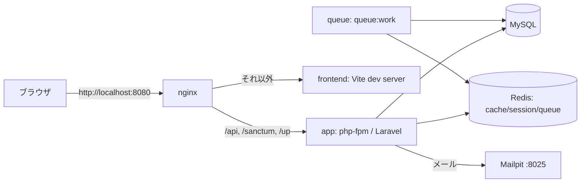
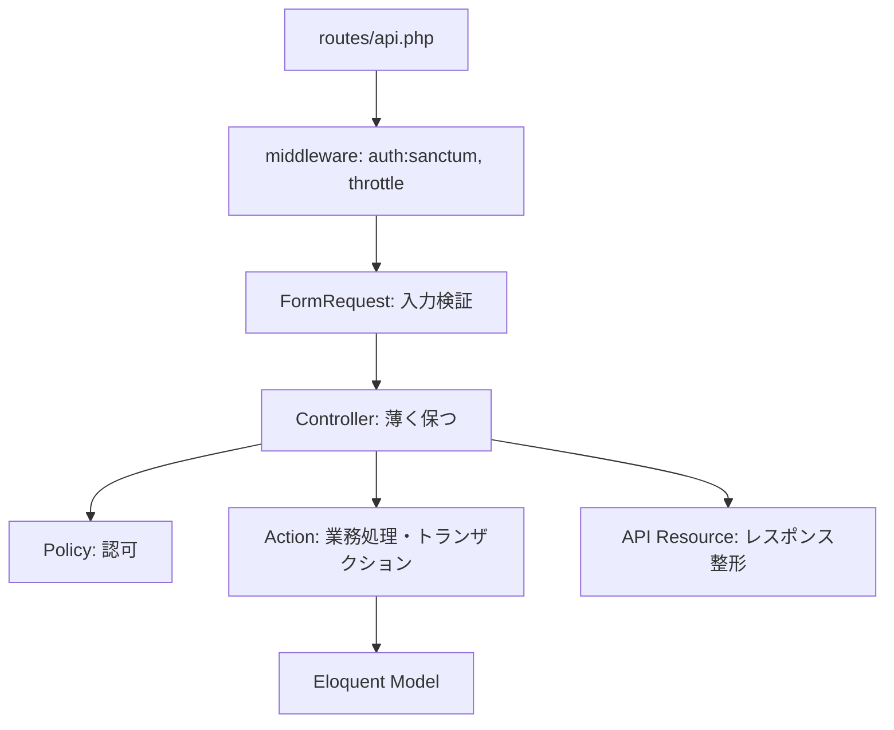

# アーキテクチャ

## 技術スタック

| 層 | 技術 |
|---|---|
| バックエンド | PHP 8.4 / Laravel 13 / Laravel Sanctum |
| フロントエンド | React 19 / TypeScript / Vite / React Router / TanStack Query / Tailwind CSS |
| DB・キャッシュ | MySQL 8.4 / Redis 7 |
| 開発環境 | Docker Compose |
| CI | GitHub Actions |

## システム構成（開発環境）



- nginx を入口にして、API と画面を**同じオリジン**（localhost:8080）で配信する
- これにより CORS 設定が不要になり、Cookie 認証がそのまま動く
- 本番では frontend コンテナは使わず、ビルド済みの静的ファイルを nginx が配信する

## バックエンドのレイヤー



| 層 | 責務 | やらないこと |
|---|---|---|
| FormRequest | 入力の形式チェック | DB の更新 |
| Controller | 受け取って、呼んで、返す | 業務ロジック |
| Policy | 「この人がこの操作をしてよいか」 | 入力チェック |
| Action | 1つの業務処理（例：プロジェクト作成＋オーナー登録） | HTTP の知識 |
| Resource | JSON の形を決める | DB の検索 |

## フロントエンドの構成

```
src/
├── app/         ルーター、レイアウト
├── lib/         HTTP クライアント、共通処理
├── types/       API の型定義
├── components/  共通 UI 部品
└── features/    機能ごとのフォルダ（auth, projects, tasks, comments）
```

機能ごとにフォルダを分ける（feature-based）ことで、機能を追加・削除するときに影響範囲がそのフォルダに閉じる。
