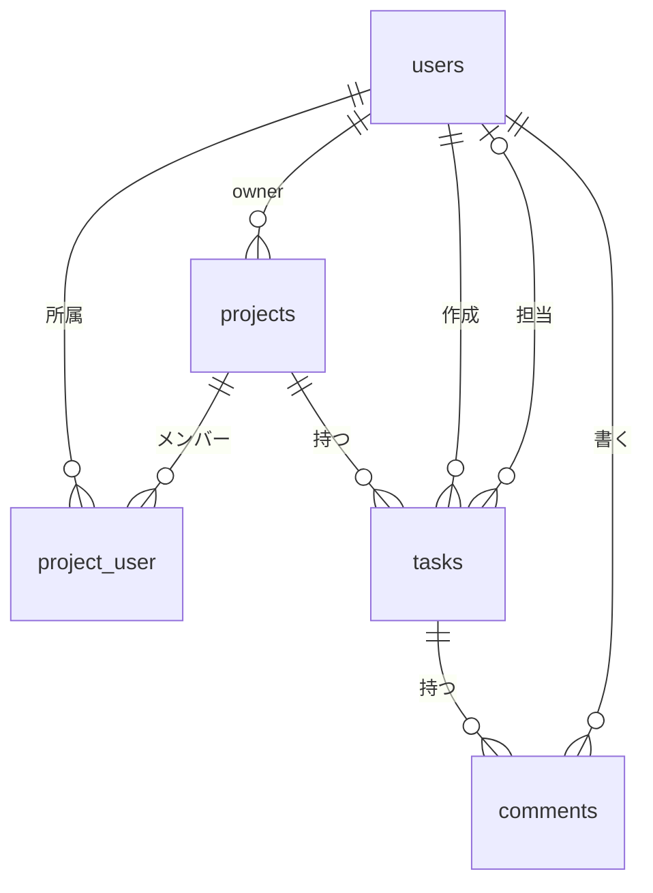

# データベース設計

## ER図

## テーブル定義

### users（Laravel 標準）
| カラム | 型 | 制約 | 説明 |
|---|---|---|---|
| id | bigint | PK | |
| name | varchar(255) | NOT NULL | |
| email | varchar(255) | UNIQUE | |
| password | varchar(255) | NOT NULL | bcrypt |
| created_at / updated_at | timestamp | | |

### projects
| カラム | 型 | 制約 | 説明 |
|---|---|---|---|
| id | bigint | PK | |
| owner_id | bigint | FK → users.id, CASCADE | 作成者 |
| name | varchar(100) | NOT NULL | |
| description | text | NULL | |
| created_at / updated_at | timestamp | | |
| deleted_at | timestamp | NULL | 論理削除 |

### project_user（中間テーブル）
| カラム | 型 | 制約 | 説明 |
|---|---|---|---|
| id | bigint | PK | |
| project_id | bigint | FK → projects.id, CASCADE | |
| user_id | bigint | FK → users.id, CASCADE | |
| role | varchar(20) | NOT NULL, default 'member' | owner / admin / member |
| created_at / updated_at | timestamp | | |

- UNIQUE (project_id, user_id)：同じ人を二重に登録しない

### tasks
| カラム | 型 | 制約 | 説明 |
|---|---|---|---|
| id | bigint | PK | |
| project_id | bigint | FK → projects.id, CASCADE | |
| created_by | bigint | FK → users.id, CASCADE | 作成者 |
| assignee_id | bigint | FK → users.id, SET NULL, NULL | 担当者 |
| title | varchar(200) | NOT NULL | |
| description | text | NULL | |
| status | varchar(20) | default 'todo' | todo / in_progress / done |
| priority | varchar(20) | default 'medium' | low / medium / high |
| due_date | date | NULL | 期限 |
| position | int unsigned | default 0 | 列内の並び順 |
| created_at / updated_at | timestamp | | |
| deleted_at | timestamp | NULL | 論理削除 |

- INDEX (project_id, status, position)：カンバンの列ごとの取得を速くする

### comments
| カラム | 型 | 制約 | 説明 |
|---|---|---|---|
| id | bigint | PK | |
| task_id | bigint | FK → tasks.id, CASCADE | |
| user_id | bigint | FK → users.id, CASCADE | |
| body | text | NOT NULL | |
| created_at / updated_at | timestamp | | |

## 設計メモ
- **status / priority を MySQL の ENUM 型にしない**：値を追加するたびにテーブル変更が必要になるため。varchar + PHP の Enum で管理する
- **担当者が削除されたら SET NULL**：タスク自体は残したいため
- **プロジェクトとタスクは論理削除**：誤削除からの復旧と監査のため
