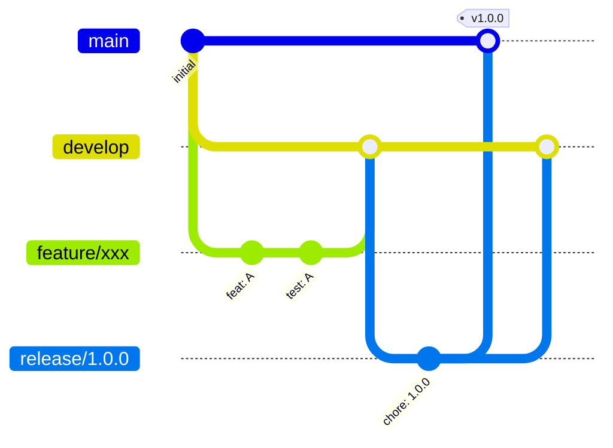

# Git 運用ルール

## ブランチ戦略



| ブランチ | 用途 | 派生元 | マージ先 |
|---|---|---|---|
| `main` | 本番。常にリリース可能な状態 | - | - |
| `develop` | 開発の統合先（デフォルトブランチ） | main | release 経由で main |
| `feature/<内容>` | 機能開発 | develop | develop |
| `fix/<内容>` | develop 上のバグ修正 | develop | develop |
| `chore/<内容>` | 設定・CI・依存更新 | develop | develop |
| `release/<x.y.z>` | リリース準備 | develop | main と develop |
| `hotfix/<x.y.z>` | 本番の緊急修正 | main | main と develop |

- `main` と `develop` はルールセットで保護（PR 必須・force push 禁止・削除禁止）
- ブランチ名は英小文字とハイフン（例：`feature/tasks-api`）

## コミットメッセージ（Conventional Commits）

```
<type>(<scope>): <要約>

<本文：なぜ変更したか（任意）>
```

| type | 使うとき |
|---|---|
| feat | 機能を追加した |
| fix | バグを直した |
| docs | ドキュメントだけ変えた |
| style | 見た目の整形だけ（動作は同じ） |
| refactor | 動作を変えずにコードを整理した |
| test | テストを追加・修正した |
| chore | 設定・依存・ビルドなど |
| ci | CI の設定 |
| perf | 性能を改善した |

scope の例：`api`, `ui`, `docker`, `db`, `auth`

- 1コミット = 1つの意図。「マイグレーション」「モデル」「テスト」は分けてコミットする
- 要約は50文字以内

## 作業の流れ

```bash
git switch develop
git pull
git switch -c feature/xxx
# 作業 → git add → git diff --staged → git commit（何回でも）
git push -u origin feature/xxx
# GitHub で develop 向けに PR を作成 → セルフレビュー → マージ
git switch develop
git pull
git branch -d feature/xxx
```

## PR のルール
- テンプレートに沿って書く
- 1つの PR は1つの機能・目的に絞る（目安：差分400行以内）
- マージ方法は「Create a merge commit」（feature 内の細かいコミットを残すため）
- マージ後は GitHub 上のブランチを削除する
